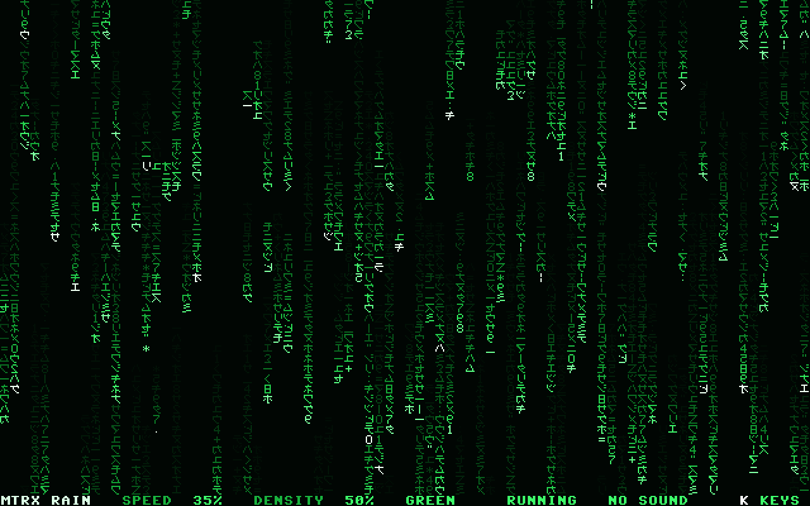
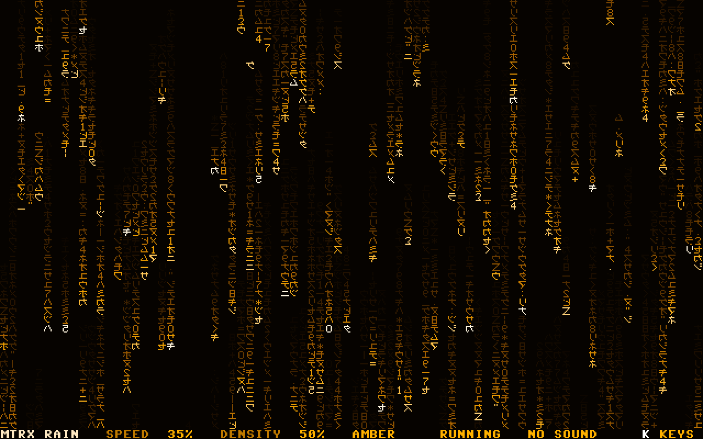
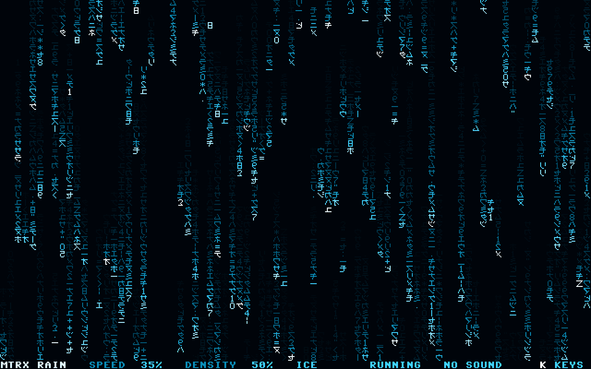
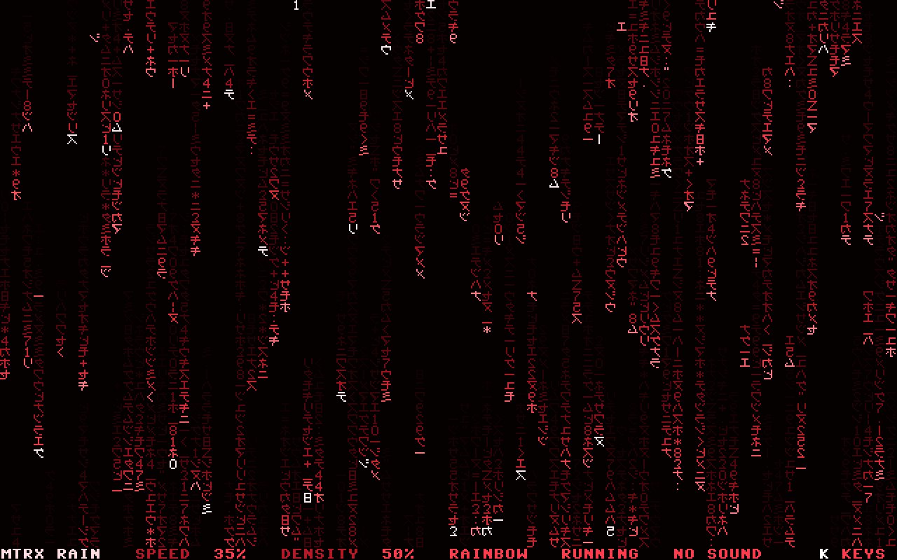

# MTRX RAIN

Digital rain for the MEGA65, in 80 x 50 text. Strings of light fall through glyphs that stay where
they are: half-width katakana, the kanji for sun, Z, digits and signs, all mirrored. One string in
five has a white head; some strings only erase; some appear halfway down; the glyphs of some
strings change all on one tick. 128 levels of light, five palettes, the sound on four SIDs, and
time that stops when you ask it to.

Version 1.0, 5 November 2026.

A 42-second video of RAINBOW, full screen (K hides the bottom row) and silent:
[docs/mtrx-rain-rainbow.mp4](docs/mtrx-rain-rainbow.mp4). It is made on a PC from the program's own
output: every frame the engine builds, through a model of the VIC-IV.

## Run

Made for PAL (50 Hz). The engine has rates for NTSC (60 Hz) too, but they have not run on a
MEGA65.

1. Copy `MTRX-RAIN.D81` from the release to the SD card.
2. `MOUNT "MTRX-RAIN.D81"`
3. `LOAD"*",8,1`, then `RUN`

The disk's SHA-256: `a61a9a3f5b2e9453d6fa0134f151e639c863f251b32f023e228da005e05c736e`.

The opening card, then the rain. The bottom row shows the settings; K shows the keys.

## Keys

| Key | What it does |
|---|---|
| SPACE, or FIRE (either port) | time stops, and runs again |
| CRSR left and right, or the stick | speed, 20 % to 250 % |
| CRSR up and down, or the stick | density, 20 % to 100 % |
| P | the palette: GREEN, AMBER, ICE, PAPER, RAINBOW |
| S | the sound: SOUND, HUMM, SOUND+HUMM, NO SOUND |
| K | the bottom row: the keys, nothing, the settings |
| Q or RUN/STOP | the end |

It starts at speed 35 %, density 50 %, GREEN, and silent (NO SOUND).

## The palettes

GREEN, AMBER, ICE, PAPER and RAINBOW. RAINBOW goes round the colour wheel from green, one step in
256 for every new string: it only moves on, faster when the rain is busier, and stands while time
stands.

## How it works

BASIC 65 shows the opening card, switches to 80 x 50 text, loads the engine into bank 4 and calls
it; the engine runs the rain until Q or RUN/STOP and puts back everything it changed: the VIC-IV's
registers, the palette, the SIDs. BASIC then returns the screen to the mode it found.

- **Screen**: the VIC-IV's 80 x 50 text from a screen and a character set of the engine's own.
  Multicolour mode with FCOLMCM lets a glyph's colour byte pick from the whole palette; with bit 3
  clear the glyph stays one colour, which leaves 128 entries: the rain's 128 levels of light, from
  the dark to the white head (a core without FCOLMCM is detected, and the rain runs in 16 colours).
- **Rain**: a byte a cell, its class (how fast it fades) and its age, 25 ticks a second at speed
  100 %. A string never falls faster than the one ahead in its column, so they never meet; time's
  stop and start is eased over about 0.4 s.
- **RAINBOW**: each level is a white part and a share of a hue, both taken from GREEN; the hardware
  multiplier computes the 128 colours when the hue moves on.
- **Engine**: 6502 code with a few 45GS02 instructions (the base page, (zp),Z and its 32-bit form),
  3.7 KB of code and 6.2 KB of tables; interrupts off while it runs.
- **Sound**: SOUND is a noise tick on SID 2 or 4, by the column, each time a white head lights a
  cell; HUMM is a drone on SIDs 1 and 3 (A1, E2 as a pulse whose width breathes, and A0) that drops
  an octave when time stops. Filters off.

`mega65/model.py` is the specification in Python; the tests check the engine against it: every
cell's colour, the bottom row, the palettes.

## Source

| Path | What |
|---|---|
| `mega65/mtrx.b65` | the program: readable BASIC 65 source |
| `mega65/psinco-card.b65` | the opening card |
| `mega65/glyphs.py` | the 53 glyphs, drawn by hand, and their mirror images |
| `mega65/model.py` | the specification: cell states, levels, palettes, rates, the bottom row; a model of the VIC-IV's 80 x 50 text |
| `mega65/gen_engine.py` | writes the engine |
| `mega65/build.py` | the engine, the program and the disk |
| `mega65/test_engine.py` | runs the engine against a model of the MEGA65 (screen, palette, keys, joysticks, multiplier, SIDs), frame by frame |
| `mega65/test_launcher.py` | runs the program in the BASIC 65 simulator |
| `mega65/media.py` | the pictures and the video, from the engine |
| `mega65/CREDITS.txt`, `mega65/LICENSE.txt` | the credits and the licence, as plain text |
| `tools/` | assembler driver, transpiler, tokeniser, BASIC 65 simulator, disk writer and checker, font |

`sh build.sh` rebuilds the release's disk in `out/`, byte for byte, and runs the quick checks. It
needs Python 3 with py65, numpy, pillow and d64; the video also ffmpeg.

## Tested on

A MEGA65 (R6A) in PAL, core 890-sdcard-native build #63 (commit 1c737937), ROM 920422.

## Credits

MTRX RAIN 1.0, 2026, by Dawid Blachowski, with Claude, Anthropic's AI.
psinco. A Software Atelier from Luxembourg.

The glyphs, the letters of the bottom row, the palettes and the sound are made by programs written
for it; no image, sample or existing tune is used. How the VIC-IV draws text was read from the
MEGA65 core's own source. Built with Python, py65, NumPy, Pillow and d64; the video made with
FFmpeg. Details in `mega65/CREDITS.txt`.

MIT licence: free to use, change and share, with the notice. See [LICENSE](LICENSE).
